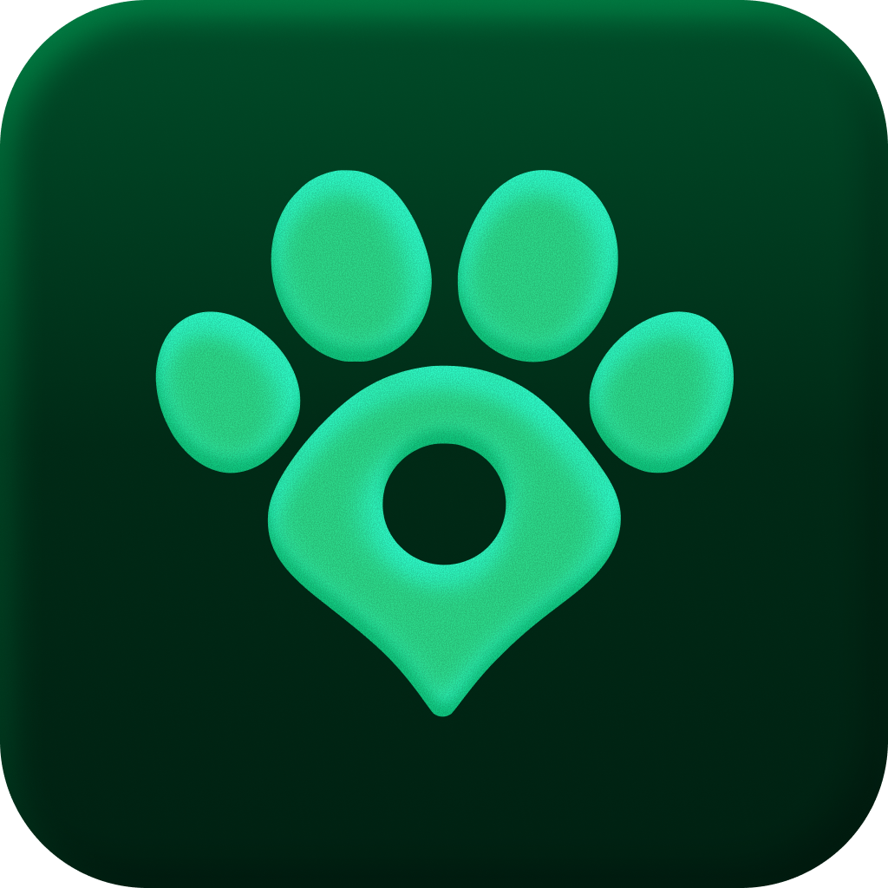

<div align="center">

  
  <h1>Entre Huellas</h1>
  <p><strong>Cada huella puede ayudar a volver a casa.</strong></p>
  <p>Proyecto grupal de recuperación colaborativa de mascotas · MVP con prioridad Android</p>
  <p>
    
    
    
    
    
  </p>
  <p>
    <a href="#primeros-pasos">Primeros pasos</a> ·
    <a href="#configuracion-local">Configuración</a> ·
    <a href="INSTALACION_ANDROID.md">Instalar/publicar APK</a> ·
    <a href="#trabajo-en-equipo">Colaborar</a> ·
    <a href="#documentacion">Documentación</a>
  </p>
</div>

---

## Examen práctico Unidad II — Tipo 1

Repositorio individual: https://github.com/srg-cp/examen-u2. Alcance del examen:
solo `apps/mobile`. Punto 1 implementado: entidad `CurrentLocation` con latitud,
longitud y precisión en metros; GPS encapsulado en `DeviceLocationSource`;
repositorio/caso de uso inyectados al ViewModel y coordenadas visibles en
Explorar → Mapa. La precisión se conserva aunque falle la consulta de casos.
Los puntos 2–5 están pendientes.
Actualización del punto 1: Android declara también `ACCESS_FINE_LOCATION` para
permitir elegir ubicación precisa manteniendo `LocationAccuracy.medium`.
APK debug compilado e instalado, permiso preciso activado y lectura nativa
verificada en Tacna (-18.006598, -70.246300; diferencia aproximada de 0.22 m
respecto del punto fijado). Las cinco capturas están incorporadas al Word de trabajo.

Punto 2 implementado en esta rama aislada: seguimiento con precisión media,
actualización solo con30s Y50m, timeout inicial de10s y cancelación al salir del
mapa con log «GPS detenido».29 pruebas aprobadas, análisis sin incidencias y APK
debug compilado/instalado. [Capturas reales y registros](docs/evidencias/examen-u2-punto-2/README.md).
Los puntos3–5 se desarrollan aparte. El punto2 no se publica en origin/entrehuellas.

Archivos móviles afectados (relativos a `apps/mobile`):

- `lib/features/explore/domain/entities/current_location.dart`
- `android/app/src/main/AndroidManifest.xml`
- `lib/features/explore/domain/repositories/current_location_repository.dart`
- `lib/features/explore/domain/use_cases/get_current_explore_location.dart`
- `lib/features/explore/data/data_sources/device_location_source.dart`
- `lib/features/explore/data/repositories/current_location_repository_impl.dart`
- `lib/features/explore/presentation/state/explore_state.dart`
- `lib/features/explore/presentation/view_models/explore_view_model.dart`
- `lib/features/explore/presentation/screens/explore_map_screen.dart`
- `lib/features/explore/presentation/widgets/explore_case_map.dart`
- `test/current_location_test.dart`, `test/explore_filter_draft_test.dart`,
  `test/explore_map_test.dart` y `test/support/fake_current_location.dart`.

Archivos adicionales del punto 2:

- `android/app/src/main/AndroidManifest.xml` (permiso FINE de125c04d junto a COARSE).
- `lib/features/explore/domain/failures/explore_failure.dart`
- `lib/features/explore/domain/use_cases/watch_current_explore_location.dart`
- `lib/features/explore/presentation/view_models/explore_map_location_view_model.dart`
- `lib/features/explore/providers/explore_providers.dart`
- `test/examen_location_tracking_test.dart` y `test/examen_map_location_screen_test.dart`

Detalle y alcance: [ficha del examen](docs/funcionalidades/examen-u2.md).

### Punto 3 en worktree aislado

Círculo GPS cuyo radio es `accuracyMeters`, etiqueta «Precisión ± N m», créditos
OpenStreetMap y selección manual cuando la ubicación no está disponible. La
selección aplica el punto a la búsqueda real sin inventar precisión. Rama
`feature/examen-u2-punto-3`, base `125c04d`; sin integración en el proyecto principal.
43 pruebas locales aprobadas. Integración con punto 2 y capturas nativas pendientes;
[contrato y validación](docs/funcionalidades/examen-u2-punto-3.md).

Archivos móviles afectados, relativos a `apps/mobile`:

- `lib/features/explore/presentation/widgets/explore_case_map.dart`
- `lib/features/explore/presentation/screens/explore_map_screen.dart`
- `lib/core/presentation/widgets/map_attribution.dart`
- `lib/core/presentation/widgets/map_case_sheet.dart`
- `lib/core/presentation/widgets/zone_map_picker.dart`
- `test/examen_location_map_test.dart`

## 🐾 Sobre el proyecto

Entre Huellas conecta a quienes buscan una mascota con personas que pueden aportar información para recuperarla. El MVP contempla búsquedas de mascotas perdidas, avisos vinculados, fichas públicas mediante QR y seguimiento de la recuperación.

Las coincidencias visuales también forman parte del MVP (HU-25/#71 y HU-26/#72),
con hallazgos independientes y revisión humana. La implementación está en
`feature/case-matching`; el patch040 fue aplicado según confirmación del usuario.
La evaluación con fotos autorizadas, la prueba entre dos cuentas y la aceptación
siguen pendientes. Consulta el [recorrido y la configuración](docs/funcionalidades/coincidencias-de-casos.md).

La app cuenta con implementaciones de acceso y onboarding por cuenta, perfil, mascotas y fotos, zonas de interés, preferencias de alertas, búsquedas y avisos vinculados, y consulta de Mis reportes. **Implementado no significa historia cerrada ni despliegue confirmado**: la evidencia y los pendientes se registran en [las fichas funcionales](docs/funcionalidades/README.md) y [el estado del proyecto](docs/ESTADO.md).

Explorar, la web pública QR y la entrega real de alertas tienen trabajo pendiente. Guardar preferencias de alertas no implica que ya se envíen notificaciones. Consulta el alcance en [la guía del MVP](docs/GUIA_MVP.md).

<a id="primeros-pasos"></a>

## 🚀 Primeros pasos

Las aplicaciones se organizan en dos directorios:

- [apps/mobile](apps/mobile/README.md): Flutter para Android y futuras plataformas móviles.
- [apps/platform](apps/platform/README.md): Vue/Nuxt/TypeScript para la plataforma web.

Base de datos, funciones y documentación permanecen en database, supabase y docs.
Para desarrollar la web, seguir [la guía Vue](apps/platform/DESARROLLO.md);
los pasos siguientes corresponden a Flutter. Véase [ADR-059](docs/decisiones/059-directorios-apps-platform-mobile.md).

Esta guía está dirigida a los integrantes del equipo que van a ejecutar o desarrollar la app desde el código fuente.

### 1. Preparar el equipo

| Herramienta | Referencia del proyecto |
| --- | --- |
| Git | Clonar el repositorio y trabajar con ramas |
| Flutter | **3.35.3 stable**, versión fijada en el workflow Flutter |
| Dart | **3.9.2**, incluido en esa instalación de Flutter |
| Android Studio / Android SDK | SDK, herramientas y emulador para Android |
| Editor | VS Code con extensiones Dart/Flutter o Android Studio |
| Dispositivo | Emulador iniciado o teléfono Android con depuración USB |

Comprueba tu instalación:

```powershell
flutter --version
flutter doctor
flutter devices
```

Resuelve los requisitos Android que indique `flutter doctor`. Si faltan licencias, revisa sus términos mediante `flutter doctor --android-licenses`.

### 2. Clonar e instalar dependencias

Con acceso al repositorio:

```powershell
git clone https://github.com/srg-cp/entrehuellas.git
Set-Location entrehuellas
Set-Location apps/mobile
flutter pub get --enforce-lockfile
```

La app se conserva en **`apps/mobile`**. No hay que regenerarla ni trasladarla. Si ya tienes una copia, utiliza esa copia y revisa sus cambios antes de actualizarla.

<a id="configuracion-local"></a>

## 🔑 Archivo de configuración

**La plantilla que necesitas ya está incluida:** [supabase.local.example.json](apps/mobile/config/supabase.local.example.json).

Desde la carpeta de la app, cópiala una sola vez:

```powershell
Copy-Item config/supabase.local.example.json config/supabase.local.json
```

Si `config/supabase.local.json` ya existe, conserva tu configuración. El responsable del proyecto **compartirá internamente los valores del entorno de desarrollo** para completar ese archivo.

| Campo | Qué colocar |
| --- | --- |
| `SUPABASE_URL` | URL HTTPS del entorno de desarrollo compartido |
| `SUPABASE_PUBLISHABLE_KEY` | Clave publicable del mismo entorno, con prefijo `sb_publishable_` |
| `EMAIL_OTP_VALIDITY_MINUTES` | Minutos de validez del código, solo si coinciden con la configuración real del servidor |

La plantilla contiene `15` para la validez del código: confírmalo con el responsable. Si el plazo no está confirmado, elimina ese campo; la app puede mostrar la instrucción sin afirmar una duración. Este valor informa en la interfaz y **no modifica la caducidad del servidor**.

> El archivo `*.local.json` está ignorado por Git. No lo adjuntes a issues ni pull requests. Flutter incorpora estos valores al cliente: aquí solo van datos de configuración pública, nunca `service_role`, claves secretas, contraseñas SQL o tokens personales.

No necesitas acceso administrativo a Supabase para ejecutar la app. Usa una cuenta de prueba propia y coordina con el responsable la activación del backend que requiera tu módulo. Copiar el JSON no crea tablas, políticas, funciones ni buckets.

## ▶️ Ejecutar la app

Desde `apps/mobile`, con el emulador o teléfono disponible:

```powershell
flutter run --dart-define-from-file=config/supabase.local.json
```

Si hay varios dispositivos, consulta `flutter devices` y añade `-d <id-del-dispositivo>` al comando. Al modificar la configuración, detén y vuelve a ejecutar la app: hot reload no actualiza los valores de compilación.

En **VS Code**, selecciona **Entre Huellas - desarrollo local** en Ejecutar y depurar, elige el dispositivo y pulsa **F5**. Ese perfil utiliza el mismo archivo local.

El recorrido comienza en acceso; una cuenta que no completó el onboarding debe finalizar sus tres etapas antes de entrar. El retorno móvil utiliza `entrehuellas://login-callback/`; su configuración y las pruebas reales de acceso están en [CONFIGURACION.md](docs/CONFIGURACION.md).

Si falla el acceso o falta una función remota, confirma el entorno y la activación del incremento con el responsable. No ejecutes todo el SQL sobre el servidor compartido para intentar resolverlo.

## 📦 Instalar y publicar Android

La [guía paso a paso de instalación y distribución](INSTALACION_ANDROID.md)
explica cómo generar y respaldar la firma, completar el JSON local, guardar los
cinco secrets en GitHub, activar la compilación desde `main` o `exuii-colque`, descargar el APK
e instalarlo o actualizarlo en un teléfono. Incluye compilación local y solución
de errores, con comandos e indicaciones de dónde ejecutar cada paso.

El workflow está preparado para publicar una **prerelease con APK firmado e IPA** por
cada push a `main` o `exuii-colque` que supere las validaciones y ambas compilaciones.
Las del examen usan `exuii-colque-build-N`; main conserva `android-build-N`.
El usuario confirmó el24/10 la
configuración de firma, los cinco secrets y `key.properties` local; el
[inventario y estado de preparación](INSTALACION_ANDROID.md#estado-de-la-preparacion)
indica de dónde sale cada dato y los pendientes de respaldo, integración y
validación de Actions. No implica despliegue de Supabase
ni publicación en Google Play. Quien solo instala el APK no necesita Flutter,
el JSON ni las credenciales de firma.

<a id="trabajo-en-equipo"></a>

## 🤝 Trabajo en equipo

### Antes de empezar un módulo

1. Acuerda la **HU/RF**, el issue, los criterios de aceptación y los límites de la entrega. El identificador de historia y el número del issue son distintos.
2. Confirma la rama o commit de partida. `main` es la base integrada; si necesitas trabajo aún no integrado, acuerda expresamente otra base.
3. Lee [AGENTS.md](AGENTS.md), [las reglas de arquitectura](docs/REGLAS_ARQUITECTURA.md), [la arquitectura](docs/ARQUITECTURA.md), [el estado](docs/ESTADO.md), el sprint y la ficha funcional correspondientes.
4. Si modificas pantallas, lee también [las reglas de UI/UX](docs/REGLAS_UI_UX.md) y [la guía de diseño](docs/DISENO_UI.md).
5. Coordina contratos compartidos, cambios en router/bootstrap/core y numeración SQL antes de trabajar sobre ellos.

Con tu copia limpia y usando `main` como base acordada, desde la raíz del repositorio:

```powershell
git status
git switch main
git pull --ff-only origin main
git switch -c feature/nombre-del-modulo
```

### Arquitectura de cada entrega

```text
Pantalla → ViewModel → Caso de uso → Contrato de repositorio
                                      ↑ implementación inyectada
                             Repositorio de data → Fuente de datos → SDK
```

- **Dominio:** entidades, contratos, casos de uso y fallos independientes de Flutter, Riverpod y Supabase.
- **Presentación:** pantallas, widgets, ViewModels y estado. Los widgets consumen ViewModels; las operaciones de producto pasan por casos de uso.
- **Datos:** DTO, repositorios y fuentes de datos que encapsulan el SDK. Bootstrap/main inyectan las implementaciones.
- **Colaboración entre módulos:** mediante dominio y providers declarativos; sin importar presentation/data de otra funcionalidad ni features desde core.
- **Interfaz:** reutilizar los componentes aprobados. Toast superior para validación, errores y resultados; skeleton y `LoadingShimmer` para carga. Sin SnackBar, errores bajo inputs ni indicadores circulares/lineales.
- **Persistencia:** permisos y reglas críticas también en servidor. SQL versionado, migraciones generadas y RLS comprobada según [database/README.md](database/README.md). No modificar migraciones aplicadas ni editar manualmente `run_all.sql`.

Entrega incrementos completos por funcionalidad: comportamiento, persistencia, permisos, estados y pruebas pertinentes. No añadas funcionalidades futuras solo porque figuran en el plan maestro.

### Antes de entregar el pull request

Desde la carpeta de la app:

```powershell
dart format --output=none --set-exit-if-changed lib test
flutter analyze --no-pub
flutter test --no-pub
```

Si cambias dependencias, resuélvelas primero y entrega el lockfile actualizado. El comando de formato comprueba cambios: si falla, aplica `dart format lib test` y vuelve a comprobar.

- Revisa el diff y comprueba que no contiene configuración local ni secretos.
- Verifica los criterios, fallos, reintentos y permisos afectados. Para UI, revisa tamaño normal, pantalla pequeña y texto ampliado.
- Actualiza [ESTADO.md](docs/ESTADO.md) y la ficha de [funcionalidades](docs/funcionalidades/README.md); registra pruebas ejecutadas y pendientes reales.
- Abre el PR hacia la base acordada con [la plantilla del repositorio](.github/pull_request_template.md), vincula el issue y solicita revisión antes de integrar.
- Acuerda con el responsable cualquier despliegue, migración o cambio del entorno compartido.

El [workflow Flutter](.github/workflows/flutter.yml) define formato, análisis y pruebas; sus ejecuciones se consultan en [GitHub Actions](https://github.com/srg-cp/entrehuellas/actions). Una prueba local aprobada no confirma un despliegue ni una validación real en Android/Supabase.

## 🗂️ Mapa del repositorio

```text
entrehuellas/
├── apps/mobile/   App Flutter existente
│   ├── config/                        Plantillas de configuración
│   ├── lib/app/                       Bootstrap, aplicación y router
│   ├── lib/core/                      Configuración y componentes compartidos
│   ├── lib/features/                  Domain, data, presentation y providers por funcionalidad
│   └── test/                          Pruebas, incluidas fronteras arquitectónicas
├── database/                          Fuentes SQL y generadores de migraciones
├── supabase/                          Migraciones, Edge Functions y configuración de servidor
├── docs/                              Reglas, funcionalidades, backlog y decisiones
├── logo/                              Originales del icono del sistema
└── .github/                           Workflows y plantillas de colaboración
```

<a id="documentacion"></a>

## 📚 Documentación

| Necesitas… | Consulta |
| --- | --- |
| Preparar el entorno y diagnosticar acceso | [Configuración y validación](docs/CONFIGURACION.md) |
| Configurar firma/secrets, publicar, instalar o actualizar el APK | [Instalación y distribución Android](INSTALACION_ANDROID.md) |
| Conocer lo implementado y sus pendientes | [Estado](docs/ESTADO.md) · [Funcionalidades](docs/funcionalidades/README.md) |
| Elegir y delimitar una entrega | [Guía MVP](docs/GUIA_MVP.md) · [Backlog](docs/BACKLOG_MVP.md) |
| Respetar las fronteras de código | [Reglas](docs/REGLAS_ARQUITECTURA.md) · [Arquitectura](docs/ARQUITECTURA.md) |
| Mantener la interfaz consistente | [Reglas UI/UX](docs/REGLAS_UI_UX.md) · [Diseño](docs/DISENO_UI.md) |
| Entender las decisiones técnicas | [ADR-001](docs/decisiones/001-arquitectura-aplicacion.md) · [Decisiones](docs/decisiones/) |
| Modificar datos o permisos | [Base de datos](database/README.md) |
| Actualizar el icono Android | [Fuentes y regeneración](logo/README.md) |
| Trabajar con un asistente de código | [Instrucciones del proyecto](AGENTS.md) |

---

<div align="center">
  <sub>Entre Huellas · Recuperación colaborativa de mascotas</sub>
</div>
