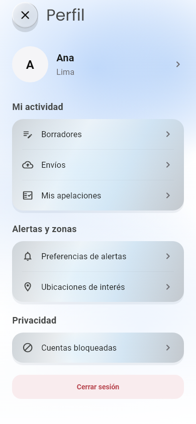
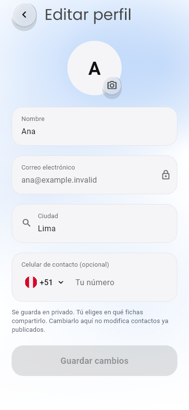
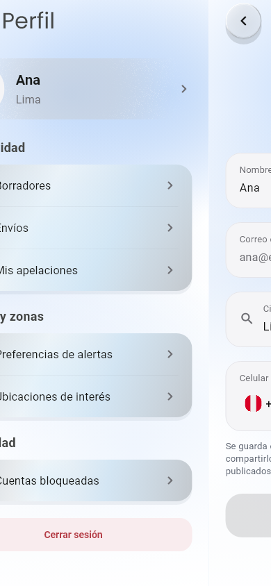
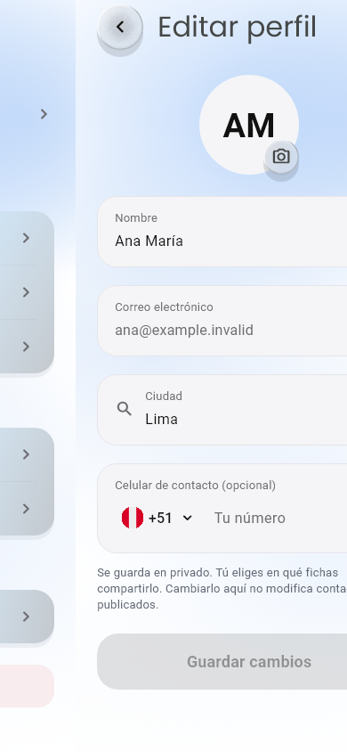
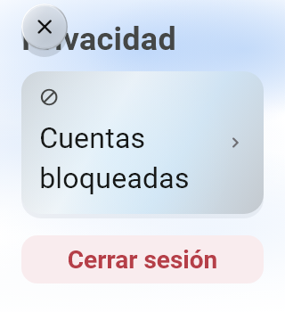
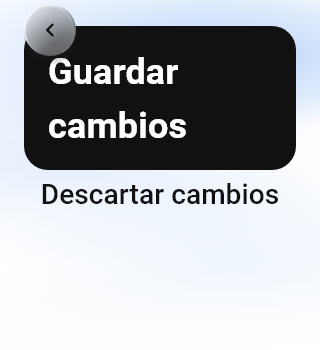

# Perfil móvil: revisión de la UI aprobada

Fecha: 30/10/2026, America/Lima.
Decisión: [ADR-171](../decisiones/171-perfil-agrupado-y-navegacion-horizontal-mobile.md).
Funcionalidad: [Perfil](../funcionalidades/perfil.md).

Implementación Flutter de los mockups aprobados en el chat: resumen con chevrón,
tres grupos de opciones y editor aparte. Las imágenes siguientes son renders de
widgets reales con datos de prueba (Ana/Lima), fuentes locales y fondo detenido
para inspección. No son capturas de un dispositivo físico ni datos de una cuenta
real, y no sustituyen su comprobación táctil.

## Composición normal —390×844

El resumen no monta el formulario. La fila completa de identidad abre el editor;
Guardar cambios está deshabilitado hasta editar. Tarjetas perla y controles
polished usan materiales compartidos; campos conservan los componentes de la app.

## Apertura y cierre

Se comprueban posiciones intermedias: editor a la derecha y resumen a la izquierda
al abrir; inversión al cerrar. Los seis destinos conservan su pantalla/acciones
y usan el mismo motor. No se añade stagger a la entrada horizontal; una nueva
etapa dentro del destino sí puede usar el reveal existente. Reducido es directo.

## Pantalla pequeña —320×350 y texto200%

El título pasa a fila propia y el contenido hace scroll. Cuando una palabra de
una opción no cabe junto al icono, este pasa encima para dar más ancho al texto;
se conserva material/tamaño de fuente. Una regresión comprueba que «bloqueadas»
ocupa una sola línea. El teclado se simula mediante viewInsets; no se renderiza
un teclado nativo. La navegación sigue flotando por encima del scroll.

## Evidencia y límites

- 135 pruebas de las funcionalidades y motores afectados aprobadas.
- 20 regresiones tras el ajuste de etiquetas y tres recorridos finales aprobados.
- Análisis completo y focalizado final sin incidencias; formato/diff correctos.
- Guardado confirmado, bloqueo de Atrás durante trabajo, cancelar/confirmar descarte,
  resumen actualizado, ausencia de éxito antiguo, acceso sin sesión y cambio de
  identidad comprobados. Carga/error/reintento conserva los destinos del menú.
- Capturas generadas por profile_navigation_test.dart con CAPTURE_PROFILE_UI=1 y
  AMBIENT_BACKGROUND_MOTION=false; copia completa local en build/ui-preview/profile-navigation.

Pendientes: Android físico, teclado/galería nativos, recompilación distribuible y
confirmación remota. No se cambian SQL, web, políticas ni permisos.
